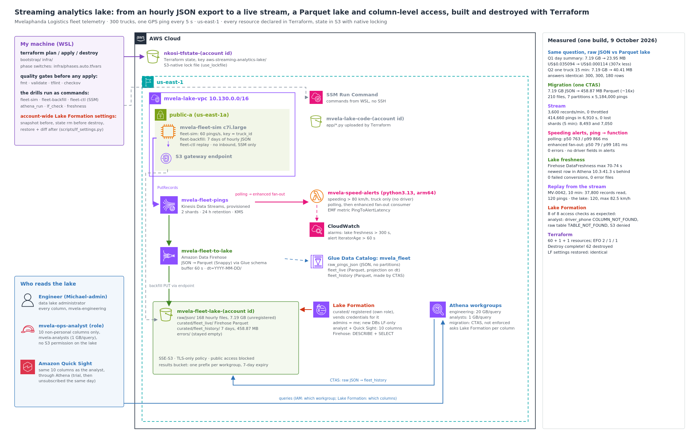

# Streaming Analytics Lake: Kinesis to a Parquet Lake with Column-Level Access, Built and Destroyed with Terraform

Mvelaphanda Logistics runs 300 trucks out of four depots: Pretoria, Johannesburg, Polokwane and Bloemfontein. Every truck has a GPS unit that takes a reading every 5 seconds, and until now the telematics vendor delivered those readings once an hour, as a JSON file. Three things went wrong with that. The control room worked an hour behind, so a truck doing 110 km/h on the N1 (heavy vehicles are limited to 80) showed up in the next file or the next morning's report. The data team kept every hourly file in one S3 folder and pointed Athena at it, so every question read every file and the bill grew with the folder. And the export carries each driver's ID and phone number, readable by anyone with Athena access: personal information under POPIA that operations analysts don't need.

I moved the fleet onto a stream and built the lake behind it. Pings go into a Kinesis data stream the moment they're taken; a Lambda function raises speeding alerts from the stream within a second; Firehose turns the same stream into Parquet files in S3, one folder per day; the old JSON history is migrated once into the same layout; and Lake Formation decides which columns each role can read, so analysts get the trucks, not the drivers.

**Every resource was declared in Terraform:** one `apply` built it, one line in a variables file switched each phase on, and one `destroy` removed everything, including the lake and every file in it.

**Headline results**

| | Result | What it proves |
|---|---|---|
| **Same question, raw JSON vs the lake** | One day's summary per truck: **7.19 GB scanned (US$0.035094) on the JSON export, 23.95 MB (US$0.000114) on Parquet**, 307 times less. One truck's 15 minutes: 7.19 GB vs **40.41 MB**. All three comparisons **identical**, row by row (300, 300 and 180 rows) | Columnar files and a day per folder let Athena read only what the question needs, with exactly the same answer |
| **Migration** | One CTAS read the 7-day export once: **36,288,000 pings, 7.19 GB of JSON became 458.87 MB of Parquet** (about 16 times smaller) in 210 files, 7 day partitions of **5,184,000** pings each | The history moved into the new layout with one statement, for US$0.035 |
| **Live stream** | **3,600 records a minute, 0 throttled**; the producer sent **414,660 pings in 6,910 s, 0 lost**; Firehose read and delivered all **414,660**, **0 failed conversions**, 0 error files | Two provisioned shards carry the fleet with room to spare, and nothing fell out between stream and lake |
| **Speeding alerts** | Ping to function: **polling p50 763 ms / p99 866 ms**; **enhanced fan-out p50 79 ms / p99 181 ms** (CloudWatch, 34,474 and 26,125 samples); 0 errors; **no driver fields in any alert** | The control room hears about a speeding truck within a second, and push delivery cut the wait by about 10 times |
| **Lake freshness** | Firehose `DataFreshness` max **70–74 s**; the newest row Athena could return was **10.3–41.3 s** behind the clock over 10 polls | The lake runs about a minute behind the trucks, not an hour |
| **Replay** | Re-reading the stream for MV-0042's 10 minutes: **37,800 records read, 120 pings found**, max 82.5 km/h; the lake returned the same **120** pings and max | A stream keeps its records for 24 hours and any reader can go back; the two copies agree |
| **Column-level access** | **8 of 8 access checks**: the analyst's `driver_phone` query fails with `COLUMN_NOT_FOUND`, `SELECT *` returns 10 columns and no driver fields, the raw table is `TABLE_NOT_FOUND`, the engineering workgroup is refused by IAM, the lake bucket is `AccessDenied` | Lake Formation filters columns for every engine that reads through it, and the analyst role has no way around it |

- **Terraform built and destroyed everything:** `Plan: 60 to add` for the base, 1 for the migration workgroup, 1 for the history grant, `2 to add, 1 to change, 1 to destroy` for enhanced fan-out, 1 added and 1 destroyed for the dashboard grant, and **`Destroy complete! Resources: 62 destroyed.`** The account's Lake Formation settings, which Terraform had replaced, were restored and compared: **identical to the snapshot taken before the build**.
- **No inbound port on the simulator** (SSM only), TLS-only buckets, an analyst role with no S3 permission on the lake, and an allow-list of columns, so a column added later stays hidden until someone decides it isn't personal.



---

## Why this project is Terraform

Apart from `aws-terraform-iac-pipeline`, I built my earlier environments from the AWS CLI, chaining commands into long sequences to save time. Most of those chains were the same work every time (VPC, subnet, route table, roles, then every delete in the right order), and I got tired of writing and re-running long, repetitive command chains. Every manual teardown also carried the risk of one forgotten delete left billing. Since `aws-dynamodb-data-modeling`, the infrastructure is code: `apply` builds it, the plan shows exactly what will change, `destroy` removes it. The commands I still run by hand are the experiments. How it's laid out: [`docs/terraform.md`](docs/terraform.md).

---

## The problem I was solving

> Move the fleet's GPS data from an hourly file to a stream, and build the lake behind it so it's fast, cheap to query and safe to share: alerts within seconds, a lake within minutes, the history migrated once, the personal columns visible only to the people who need them, and all of it built, changed and removed as code.

This continues Mvelaphanda's platform: `aws-cost-billing-dashboard` put its spending on a dashboard and `aws-resource-hygiene-automation` cleaned up what it left running. This is the first project where Mvelaphanda's own operations data is the subject.

---

## Four ideas the whole build depends on

1. **Athena charges for bytes read, so the layout is the bill.** A `WHERE` clause doesn't save money if the engine has to read every file to apply it. Columnar files (read only the columns used) and partitions (read only the folders asked for) do.
2. **One stream, several readers, each at its own pace.** Firehose batches for a minute to write efficient files; the alert function wants every record within a second; a replay goes back in time. A Kinesis data stream serves all three without them knowing about each other.
3. **Access control belongs on the data, not on each tool.** Lake Formation grants columns to a role once; Athena, and Quick Sight through Athena, ask it for every query. The analyst role doesn't even have S3 permission on the lake.
4. **Account-wide settings outlive a project.** Lake Formation's settings belong to the whole account. Terraform replaced them while this project existed; destroying that resource would not have put them back, so I saved them first and restored them last.

---

## Architecture decisions

| ADR | Decision |
|---|---|
| [0001](docs/adr/0001-kinesis-stream-with-firehose-and-lambda-readers.md) | A provisioned Kinesis data stream as the single entry point, with Firehose and Lambda as independent readers |
| [0002](docs/adr/0002-parquet-partitioned-by-day-with-partition-projection.md) | Parquet partitioned by UTC day, with partition projection instead of crawlers |
| [0003](docs/adr/0003-lake-formation-column-allow-list.md) | Lake Formation column grants as an allow-list; the analyst role gets no S3 access |
| [0004](docs/adr/0004-separate-athena-workgroups-with-scan-limits.md) | Separate Athena workgroups with scan limits, and a non-enforcing one for migrations only |
| [0005](docs/adr/0005-enhanced-fan-out-for-the-alert-function.md) | Enhanced fan-out for the alert function |
| [0006](docs/adr/0006-snapshot-and-restore-the-account-wide-lake-formation-settings.md) | Snapshot the account-wide Lake Formation settings, remove them from state before destroy, restore and diff |
| [0007](docs/adr/0007-terraform-remote-state-phase-switches.md) | Terraform with the shared S3-locked state bucket and phases as variables |

---

## How I built and measured it

1. **Before the first apply:** checked the shared state bucket (`nkosi-tfstate-<account>`, from `aws-dynamodb-data-modeling`), saved a snapshot of the account's Lake Formation settings, and made sure Athena's `default` database existed ([`docs/lake-formation.md`](docs/lake-formation.md) explains why it had to exist before Terraform ran).
2. **Quality gates:** `terraform fmt -check`, `validate`, `tflint` (recommended rules), all clean; `checkov` recorded **139 passed, 36 failed**, each triaged in [`docs/terraform.md`](docs/terraform.md).
3. **Base environment:** one saved plan, `Plan: 60 to add`, applied as reviewed. Then I checked the result through the AWS CLI: the stream, Firehose, the Glue tables, the Lake Formation settings and grants, the analysts workgroup, and the server's code (every file's SHA-256 matched Terraform's output).
4. **The old way:** `fleet-backfill` wrote 7 days of the vendor's hourly export into one flat folder: 36,288,000 pings in 168 files. Two everyday questions on it: one day's summary per truck (Q1) and one truck's track for 15 minutes (Q2).
5. **The migration:** one CTAS rewrote the export as Parquet partitioned by day; one line of Terraform then granted the analyst its columns of the new table. Q1 and Q2 again on the lake, plus Q1 without the day filter, each compared row by row with the JSON answer.
6. **Live:** the simulator started sending the whole fleet into the stream. Stream and Firehose metrics, the first Parquet files, lake freshness, the control-room view per depot, the two alarms.
7. **Alerts:** 10 minutes of the alert function polling the stream, then one line (`alerts_efo = true`) switched it to an enhanced fan-out consumer, and 8 more minutes.
8. **Replay:** one truck's 10 minutes re-read from the stream, and the same window from the lake.
9. **Access:** eight checks, one as me and seven as the analyst role, then the control-room view as the analyst.
10. **Dashboard:** Amazon Quick Sight on its free trial, reading through Athena with the analyst's 10 columns granted by Lake Formation; the grant removed and the subscription cancelled the same day.
11. **Teardown:** the fleet stopped and counted, the Lake Formation settings taken out of Terraform's state, `terraform destroy`, the settings restored and compared, and a clean check ([`docs/teardown.md`](docs/teardown.md)).

---

## What I proved

**The layout is the bill.** On the flat JSON folder, Q1 (one day, 300 rows) and Q2 (one truck, 15 minutes, 180 rows out of 36 million) each scanned the whole 7.19 GB. On the Parquet lake with the day filter, Q1 scanned 23.95 MB and Q2 40.41 MB, and both answers were identical to the JSON ones. Q2 read more than Q1 on Parquet because it uses six columns, including the coordinates, and every file holds every truck. Details: [`docs/data-layout.md`](docs/data-layout.md).

**Forgetting the partition filter didn't cost anything here, most likely because of how the files were written.** Q1 without `dt = ...` scanned exactly the same 25,117,150 bytes as Q1 with it (engine time 2,072 ms instead of 1,298). The CTAS wrote each day into its own files, so the minimum and maximum `event_ms` that Parquet keeps per block rule out every other day, which is consistent with Athena skipping those blocks after reading their footers. That is luck of the layout, not a guarantee: files that mix days (late-arriving data, a different writer) would be read in full. The partition filter is the guarantee.

**The stream carried the fleet without loss, and the lake stayed about a minute behind.** 3,600 records a minute on two shards, 0 throttled, PutRecords around 14 ms. Firehose's hourly totals (213,360 + 201,300 read; 212,734 + 201,926 delivered) both add up to the producer's 414,660. The newest row Athena could see sawed between about 10 and 41 s old across my 30-second polls, because Firehose writes a file every 60 s. Details: [`docs/streaming-and-alerts.md`](docs/streaming-and-alerts.md).

**Push beat polling for the alerts by about 10 times.** In polling mode the function ran exactly 120 times a minute (two shards, once a second each) and its pings were 763 ms old at p50 with a tight spread (p95 853 ms); with enhanced fan-out, p50 79 ms, p99 181 ms, and `IteratorAge` dropped from 761–869 ms to 109–180 ms. Switching cost a replaced event source mapping that starts at `LATEST`, so the pings in the changeover were never checked.

**A stream is replayable; a delivery isn't.** `fleet-ctl replay` opened both shards at a timestamp 15 minutes back, read 37,800 records (18,900 per shard) in 4 calls and 3.3 s, and found MV-0042's 120 pings. The lake had the same 120 pings and the same 82.5 km/h maximum. Details: [`docs/replay.md`](docs/replay.md).

**The analyst sees trucks, not drivers.** As me, the driver columns are there. As `mvela-ops-analyst`, a query that names `driver_phone` fails to resolve the column, `SELECT *` returns the 10 granted columns, the raw JSON table doesn't exist, the engineering workgroup is refused by IAM, and S3 refuses the bucket listing. Quick Sight, given the same grant, listed the same 10 fields. Details: [`docs/lake-formation.md`](docs/lake-formation.md).

### What the numbers don't say

- **Every result is one run,** on 9 October 2026. The latencies and freshness figures show the mechanism and its size, not a distribution.
- **The polling and enhanced fan-out windows aren't the same length** (10 and 8 minutes) and the function's one-alert-per-truck-per-5-minutes memory lives in each warm instance. So the alert counts (190 and 157) and their depot split aren't a comparison; the latency figures are.
- **The per-shard counts show spread, not an exact split.** 8,493 and 7,050 records came from two 5-minute windows a minute apart that include partial minutes.
- **The dashboard map wasn't captured.** I set `lat` and `lon` as geospatial fields and built the average-speed-by-depot chart; the field list (10 fields, no driver columns) is the evidence that matters.
- **The analyst's depot view and mine were taken minutes apart,** so their counts differ; each is a correct "last 15 minutes" at its own time.

---

## Debugging along the way

The surprises were in what AWS and Terraform actually did. The full list is in [`docs/debugging-journey.md`](docs/debugging-journey.md). Some of them:

- **The account's Lake Formation cross-account version was 4, not the 1 I'd assumed,** and Terraform's resource would have changed it. I pinned the value the account already had.
- **Athena's `default` database didn't exist.** It had to be created before Terraform changed the account's defaults, or it would have become Lake Formation-only too.
- **A CTAS with `external_location` is rejected in a workgroup that enforces its settings.** I added a third workgroup for migrations instead of loosening the two that analysts and engineers use.
- **My first clean-check filter, `mvela`, also matched another project's `mvelaphanda-*` resources.** Nothing of this project was left; the filter is `mvela-` now.

---

## Cost

The stream ran for 6,910 s (just under two hours) on 9 October 2026, and the whole build used about three hours of the simulator. I estimate the build at **about US$0.70** (the three full scans of the JSON export are about US$0.105 of that); the line-by-line estimate is in [`docs/cost-model.md`](docs/cost-model.md). Cost Explorer hadn't posted the build day yet when I packaged the repo; the actual figure replaces the estimate once it has. The Terraform state bucket stays on purpose and costs well under a cent a month.

---

## Compliance & frameworks

The lake holds fleet telemetry (positions, speeds, fuel) and two fields of personal information about drivers: an ID and a phone number. The phone numbers in this build are fake by construction (`+27 000 000 nnn`).

- **POPIA (South Africa)**
  - **Section 10, minimality:** the alerts carry the truck, never the driver; analysts and the dashboard receive only the 10 non-personal columns.
  - **Section 19, security safeguards:** access is decided per column by Lake Formation and tested (8 checks); data is encrypted at rest (SSE-S3, KMS for the stream) and in transit (TLS-only bucket policies); query results that could contain personal data expire after 7 days.
- **ISO/IEC 27001:2022 Annex A**
  - **A.5.15 Access control** and **A.8.3 Information access restriction:** column-level grants per role, separate workgroups, an analyst role with no direct S3 access.
  - **A.8.11 Data masking:** the personal columns are withheld from analysts and the dashboard by the grant, not by convention.
  - **A.8.9 Configuration management** and **A.8.32 Change management:** every change a reviewed Terraform plan; the account-wide setting snapshotted, restored and diffed.
- **NIST SP 800-53 Rev. 5:** **AC-3** access enforcement, **AC-6** least privilege, **SC-8** transmission confidentiality, **SC-28** protection of information at rest, **CM-3** configuration change control.

---

## Repo layout

```
.
├── README.md
├── bootstrap/main.tf                 # the shared Terraform state bucket (created in aws-dynamodb-data-modeling)
├── infra/                            # this project's Terraform
│   ├── versions.tf                   # Terraform >= 1.11, AWS provider ~> 6.60, S3 backend with use_lockfile
│   ├── variables.tf                  # settings + phase switches (history_ready, alerts_efo, quicksight_principal_arn)
│   ├── main.tf  network.tf  storage.tf  stream.tf  firehose.tf  catalog.tf
│   ├── lakeformation.tf  athena.tf  iam.tf  compute.tf  alarms.tf  outputs.tf
│   ├── templates/userdata.sh.tftpl   # the simulator's boot script
│   └── .terraform.lock.hcl           # exact provider versions used (aws 6.68.0, archive 2.8.1)
├── app/                              # on the server: fleet-sim, fleet-backfill, fleet-ctl (+ fleet.py, common.py)
├── lambda/alerts.py                  # speeding alerts + PingToAlertLatency (EMF)
├── sql/                              # every Athena query, including the CTAS
├── scripts/                          # run from WSL: SSM, Athena, CloudWatch, S3 stats, Lake Formation checks and settings
├── .tflint.hcl  env.sh.example  .gitignore
└── docs/
    ├── architecture.png / .svg  diagram/       # official AWS icons; build_architecture.py regenerates it
    ├── data-layout.md  streaming-and-alerts.md  replay.md  lake-formation.md
    ├── terraform.md  debugging-journey.md  cost-model.md  teardown.md
    ├── adr/                          # 7 decisions
    ├── results/                      # curated CSVs + raw/ (every saved output, account ID masked)
    ├── screenshots.md                # what each screenshot shows
    └── screenshots/                  # 55, in build order
```

---

## Reproduce it

From WSL, as an administrator, with Terraform >= 1.11, tflint and checkov installed. Everything runs from the repo folder. Build, measure and destroy in one sitting.

1. `cp env.sh.example env.sh && mkdir -p build/results && source ./env.sh`, then `save ACCOUNT_ID "$(aws sts get-caller-identity --query Account --output text)"`.
2. State bucket: `save STATE_BUCKET "nkosi-tfstate-$ACCOUNT_ID"` if it exists; otherwise `terraform -chdir=bootstrap init && terraform -chdir=bootstrap apply` first.
3. `python3 scripts/lf_settings.py snapshot`. Read it: if the cross-account version isn't `"4"`, set `lf_cross_account_version` to the account's value. Then `aws glue get-database --name default`; if it doesn't exist, create it now: `aws glue create-database --database-input '{"Name":"default"}'`.
4. `terraform -chdir=infra init -backend-config="bucket=$STATE_BUCKET"`, `terraform fmt -check -recursive`, `terraform -chdir=infra validate`, `tflint --recursive --config "$(pwd)/.tflint.hcl"`, `checkov -d . --framework terraform --soft-fail`.
5. `terraform -chdir=infra plan -out=base.tfplan` (61 to add from this repo: my run was 60, plus the migration workgroup added later), `terraform -chdir=infra apply base.tfplan`; save `sim_id`, `lake_bucket`, `results_bucket`, `analyst_role_arn` and `history_location` from the outputs.
6. `python3 scripts/ssm_run.py sh "$SIM_ID" "cloud-init status --wait; mvela-sync; fleet-ctl show"` and compare with `terraform -chdir=infra output -json app_sha256`.
7. `fleet-backfill --days 7` on the server (through `scripts/ssm_run.py`), then `scripts/athena_run.py` with `sql/q1_daily_json.sql` and `sql/q2_track_json.sql` in `mvela-engineering`.
8. `sql/ctas_history.sql` in `mvela-migration`, then `echo 'history_ready = true' >> infra/phases.auto.tfvars` and apply; the Parquet queries; `scripts/compare_results.py` for each pair.
9. `systemctl start fleet-sim` on the server; `scripts/cw_metrics.py`, `scripts/s3_stats.py`, `scripts/freshness.py`, `sql/live_by_depot.sql`.
10. `scripts/alert_log.py` and the latency metric; `echo 'alerts_efo = true' >> infra/phases.auto.tfvars`, apply, and measure again.
11. `fleet-ctl replay --start <15 minutes ago> --minutes 10 --truck MV-0042`, then `sql/replay_lake.sql`.
12. `python3 scripts/lf_check.py`, and `sql/live_by_depot.sql` with `--as-analyst` in `mvela-analysts`.
13. Destroy, restore and check: [`docs/teardown.md`](docs/teardown.md).

---

## What this connects to

- `aws-cost-billing-dashboard` and `aws-resource-hygiene-automation`: earlier Mvelaphanda projects (and the `mvelaphanda-*` resources my first clean-check filter caught).
- `aws-dynamodb-data-modeling`: the shared Terraform state bucket, and the stream-consumer pattern (DynamoDB Streams there, Kinesis here).
- `aws-iam-least-privilege`: one role per job; here Lake Formation adds the column level that IAM can't express.
- `aws-kms-encryption-architecture`: the stream uses the AWS managed key; that project is where a customer managed key would come from.
- `aws-private-connectivity-endpoints`: the free S3 gateway endpoint the 7.19 GB backfill used.
- `aws-terraform-iac-pipeline`: the remote-state pattern every project now reuses.
